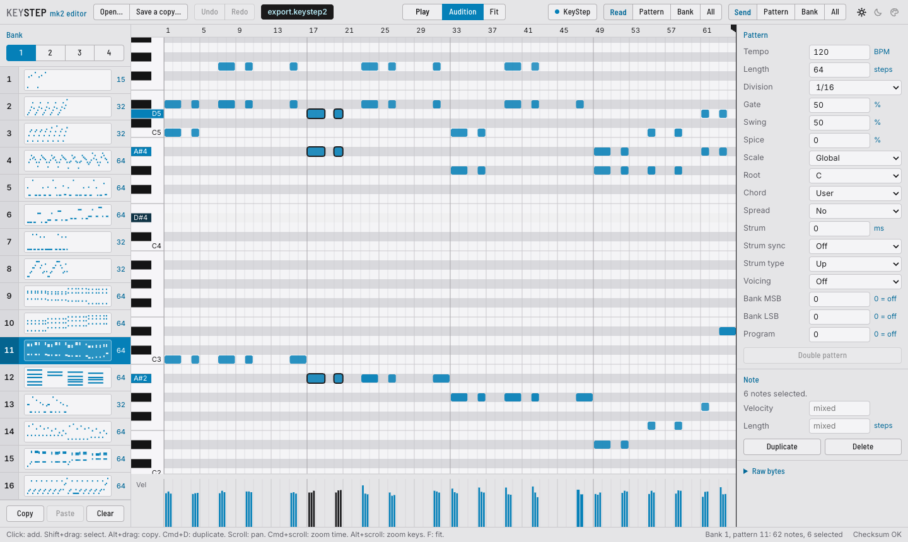

# KeyStep mk2 pattern editor

[](https://keystep2-editor.vercel.app)

[](https://keystep2-editor.vercel.app)

A browser editor for the sequencer patterns of the Arturia KeyStep mk2. It opens the `.keystep2`
project files that Arturia MIDI Control Center (MCC) exports, shows every pattern in a piano roll,
and saves an edited copy you can import again.

It also documents the file format, worked out from an export: see [File format](#file-format).

Unofficial. Not affiliated with or endorsed by Arturia; KeyStep is their trademark.

## What it does

- **All 64 slots:** four banks of 16 patterns, each with a note preview and its length.
- **Piano roll:** add, move, resize, copy and duplicate notes, alone or as a selection; up to 8
  notes per step and 64 steps per pattern, the same limits as the device.
- **Velocity lane** under the grid.
- **Pattern settings** in real units: tempo, length, time division, gate, swing, spice, scale,
  root, chord and strum settings, bank and program change.
- **Preview playback** with a playhead and lit keys.
- **Pan and zoom** on both axes.
- **Raw-byte inspector:** the step record, header words and checksum behind what you see.
- **Skins:** Light (after the white hardware), Dark and Classic.
- **Direct to the device:** in Chrome or Edge, read patterns from a KeyStep mk2 connected by USB
  and send edited ones back, without MIDI Control Center.
- **Local only:** files and MIDI stay in the browser. Nothing is uploaded.

## Getting started

1. In MIDI Control Center, export your KeyStep mk2 project. This gives a `.keystep2` file.
2. Open [keystep2-editor.vercel.app](https://keystep2-editor.vercel.app) and drop the file on the
   window, or press Open.
3. Edit, then press "Save a copy…". The file you opened is never overwritten.
4. Import the copy in MIDI Control Center.

Keep your original export. See [Status](#status) for what has and has not been verified.

### Working on the device directly

Needs Chrome or Edge (Web MIDI with SysEx) and the KeyStep mk2 connected by USB. Close MIDI Control
Center first.

The editor starts with an empty project of 64 slots, so no file is needed.

1. Press **Connect KeyStep** and allow MIDI access when the browser asks.
2. Pick a bank and slot, then use the **Read** group to load from the device.
3. Edit.
4. Use the **Send** group to write back.

| Scope | Read | Send |
|-------|------|------|
| Pattern | Replaces the slot you are on. About 3 seconds | Writes the slot you are on. About 3 seconds |
| Bank | Replaces the 16 slots of the bank shown, as one undo step. About 21 seconds | Writes the slots of that bank that hold data. About a minute for 16 |
| All | Opens all 64 patterns as a new project. About 1.5 minutes | Writes every slot that holds data. About 4 minutes for 64 |

Send skips empty slots and leaves them as they are on the device, so a project with three patterns
touches three slots. Every pattern sent is read back and compared before it is reported as done; a
write that did not take is repeated once.

| Action | Cancelling |
|--------|------------|
| Read all | Keeps the patterns that arrived whole and opens them as a project; the one in progress is dropped |
| Read bank | Keeps the patterns that arrived whole; the rest of the bank stays as it was in the editor |
| Read pattern | Changes nothing |
| Send pattern | Not possible once started: a half-written pattern would be worse than the old or the new one |
| Send bank, Send all | Finishes the pattern in progress, then stops; the remaining slots are unchanged on the device |

Use one browser tab at a time: the device has a single transfer state, and two tabs or apps talking
to it at once will disturb each other.

Reading never changes the device. Before sending anything, do one **Read all** and save a copy: that
file is your backup, and MIDI Control Center can restore it.

### Running it locally

There is no build step and no dependency. Clone the repository and open `index.html`, or serve the
folder with any static server; served over HTTP it loads the bundled `export.keystep2` (the 16
factory patterns) on start.

```bash
node --test        # codec tests
```

| Path | Purpose |
|------|---------|
| `index.html` | The editor |
| `keystep2.js` | Codec: parse, edit, serialize. Reference implementation of the format |
| `keystep2-midi.js` | Pattern transfer over MIDI SysEx. Reference implementation of the protocol |
| `export.keystep2` | A factory project, used by the tests and as the demo file |
| `fonts/` | Inter and Barlow Semi Condensed (SIL Open Font License), used by the Light and Dark skins |
| `tests/` | Codec tests against `export.keystep2` |
| `tools/` | Optional read-only command-line decoder in Python. See [`tools/README.md`](tools/README.md) |

## Using the editor

| Action | How |
|--------|-----|
| Add a note | Click an empty cell |
| Select | Click a note. Shift+click adds or removes one. Shift+drag from an empty cell draws a selection box. Cmd/Ctrl+A selects all, Esc clears |
| Move | Drag a selected note (the whole selection moves), or arrow keys (Shift+Up/Down = octave) |
| Copy | Alt+drag: the originals stay and the copies travel |
| Duplicate | Cmd/Ctrl+D (also Cmd/Ctrl+B, or D): the selection repeats right after itself |
| Change length | Drag a note's right edge, or Shift+Left/Right. The grip reaches a few pixels past the end of short notes |
| Delete | Double-click, right-click, or Delete |
| Velocity | Drag in the lane under the grid (selected notes in that step, else the whole step) |
| Pattern length | Drag the marker in the ruler |
| Double pattern | Button under the pattern settings: repeats steps 1 to N as N+1 to 2N and doubles the length |
| Pan | Scroll (two fingers on a trackpad pan both ways; Shift+wheel pans time), or drag with the middle button |
| Zoom time | Cmd/Ctrl+scroll or pinch, about the pointer |
| Zoom keys | Alt+scroll, about the pointer |
| Fit | F, or the Fit button |
| Hear a key | Click or drag on the keyboard strip |
| Play / stop | Space |
| Undo / redo | Cmd/Ctrl+Z, Shift+Cmd/Ctrl+Z |
| Save | "Save a copy…" or Cmd/Ctrl+S. The opened file is never overwritten |

Clicking the grid of an empty slot creates a pattern there.

## Skins

The sun, moon and palette buttons at the right of the toolbar switch skin; the choice is remembered in the browser.

| Skin | Look |
|------|------|
| Light (default) | After the white hardware: matte white panel, blue Shift-button accent, black keys, OLED-style file readout |
| Dark | The same blue on a black body |
| Classic | Charcoal with a yellow accent |

A skin is one block of CSS custom properties on `:root[data-skin="…"]` at the top of `index.html`;
the comment above the blocks lists every token. The piano roll reads the same tokens when it draws.
To add a skin, copy a block, change the values and add a button with `data-skin` to `#skins`.

The Light and Dark colours are sampled from Arturia's product photos. This is an unofficial tool: no
Arturia logo or licensed typeface is used.

## Status

Tested with one KeyStep mk2 on firmware 1.0.2 and MIDI Control Center on macOS.

| Verified | How |
|----------|-----|
| File format | An unedited file serializes byte-identical; a project built from scratch equals MCC's export byte for byte |
| Checksum and header rules | Hold for the 16 factory patterns and for 48 blank patterns the device generated itself |
| Reading from the device | All 64 patterns read over MIDI equal MCC's export |
| Writing to the device | All 16 factory patterns, a pattern with 8 notes on every step and every setting at its maximum, one with every setting at its minimum, and one with awkward byte values were each written to a spare slot and read back: notes, all 17 settings and checksum matched every time. Other slots were unchanged |
| Cancelling a read | Cancelled at several points, including the last block of a pattern; the patterns kept and every read afterwards were byte-identical |
| Send bank, Send all | A full bank of 16 and a project with 61 empty slots were sent: every pattern matched on read-back and skipped slots were untouched. Cancelled mid-way: the pattern in progress completed and the rest were not written |
| Read bank | 16 patterns matched the device; cancelling kept the ones already read |

Not verified: other firmware versions (1.0.4 exists), importing an edited file through MCC, how a
sent pattern sounds (the checks compare data, not audio), and what the device does if a write is
interrupted. Keep a backup.

## File format

### Container

A JSON-like text file with raw binary inside string values. It is not valid JSON or UTF-8.

- `"device"`, `"version"`.
- `"B_P_ID": value`: parameter `ID` of pattern `P` (1-16) in bank `B` (1-4).
- `"BINARY_FILE_SECTION"`: marker. Everything after it is binary.
- `"BINARY_FILE_B_P_49152": "<4096 raw bytes>"`: one blob per pattern.

Blobs are unescaped and always 4096 bytes (128 blocks of 32). A blob MUST be read by length: it can
contain `"` (0x22, for example velocity 34) and bytes above 0x7F.

### Parameters

Range parameters are stored as `value - minimum`. List parameters store the index.

| ID | Name | Real range | Stored |
|----|------|-----------|--------|
| 8192 | Chord preset | User, Oct, 5th, Maj, min, sus2, sus4, Maj7, min7, Maj9, min9, Maj11, min11 | index |
| 8193 | Strum (ms) | 0-500 | 0-500 |
| 8194 | Strum sync | Off, 1/64 … 1/4 | index |
| 8195 | Strum type | Up, Alt Up, Down, Alt Down, Random | index |
| 8196 | Voicing | Off, On, Bass -1, Bass -2, Bass -3 | index |
| 8197 | Spread | No, Velocity, Aftertouch, 1-16 | index |
| 16384 | Scale | Off, Global, Major … Freygish, User | index |
| 16385 | Root | C-B | index |
| 24576 | Time division | 1/2D … 1/32T | index |
| 24577 | Length | 1-64 steps | 0-63 |
| 24578 | Gate | 10-90 % | 0-80 |
| 24579 | Swing | 50-75 % | 0-25 |
| 24580 | Tempo | 30.0-240.0 BPM | 0-2100 (tenths above 30.0) |
| 24581 | Spice | 0-100 % | 0-100 |
| 24586-24588 | Bank MSB, Bank LSB, Program change | 0 = off, 1-128 | 0-128 |

### Pattern blob

An unused slot is 4096 bytes of 0xFF.

| Offset | Size | Content |
|--------|------|---------|
| 0 | 1 | 0x00 |
| 1 | 64 | Parameter group 0x6000 (IDs 24576+), 32 little-endian words |
| 65 | 64 | Parameter group 0x2000 (IDs 8192+) |
| 129 | 64 | Parameter group 0x4000 (IDs 16384+) |
| 193 | 2304 | 64 step records of 36 bytes |
| 2497 | 1024 | Zero in every sample. Purpose unknown |
| 3521 | 4 | Checksum, little-endian, upper two bytes zero |
| 3525 | 571 | 0xFF padding |

**Header words.** The word for parameter `ID` is at `group offset + 2 × (ID & 0xFFF)` and holds
`stored value ÷ (max − min) × 32767`, rounded to nearest with halves down (gate 40/80 → 0x3FFF).
The header repeats the text parameters; a writer MUST keep both in step. The groups also hold
hidden parameters (user chord, user scale) at fixed values in every sample.

**Step record (36 bytes).**

| Offset | Size | Content |
|--------|------|---------|
| 0 | 8 | Note slots: MIDI pitch, 0x80 = empty. Filled from slot 0, lowest pitch first |
| 8 | 8 | Velocity per slot, 100 when empty |
| 16 | 8 | Length per slot in half-steps: 1 = half a step, 2 = one step, 4 = two steps. 1 when empty |
| 24 | 8 | Zero in every sample. Purpose unknown |
| 32 | 4 | Byte 34 = 1 when the step has notes; the rest zero |

All 64 records are stored whatever the pattern length; steps past the length keep their notes.

**Checksum.** XOR of the 96 header words, XOR of every step byte (193-2496), XOR 0x3FFF. The
constant is inferred: it fits all 16 samples but its origin is unknown.

## MIDI protocol

Worked out from the traffic between MIDI Control Center and the device. All of it is SysEx on the
device's USB MIDI port; MCC uses nothing else.

### Framing

```
F0 00 20 6B <7-bit packed bytes> F7
```

`00 20 6B` is Arturia's manufacturer id. The rest is an ordinary byte stream cut into 7-bit groups,
least significant bit first, the last group zero-padded. Unpacked, a request is:

| Bytes | Content |
|-------|---------|
| 1 | Sequence number, 0-127, chosen by the sender |
| 2 | Operation code, big-endian |
| rest | Arguments as CBOR: unsigned integers and byte strings, shortest form |

A reply that carries data starts with the request's sequence number with bit 7 set, followed by
CBOR values. The device also sends plain acknowledgements (bit 7 clear) after some requests; they
carry nothing a client needs.

### Operations

| Code | Arguments | Reply | Meaning |
|------|-----------|-------|---------|
| `3E69` | pattern | | Select a pattern for the parameter operations below |
| `6CD6` | parameter id | id, value | Read a parameter of the selected pattern |
| `7848` | parameter id, value | | Write a parameter of the selected pattern |
| `08DF` | pattern | 32 bytes | Read the next block of a pattern blob |
| `6E86` | pattern | | Start writing a pattern blob |
| `10AC` | 32 bytes | | Write the next block |
| `1B5D` | pattern | | Commit the pattern |
| `2A89` | parameter id | id, value | Read a global setting |
| `36FB` | parameter id, value | | Write a global setting |

- **Pattern** is `(bank − 1) × 16 + (number − 1)`, 0 to 63.
- **Parameter id** is the id from the file format (24580 for tempo, and so on).
- **Value** is 15-bit: `stored value ÷ range × 32767`. MCC rounds halves up, so 50 % gate goes out
  as `4000`; the device itself stores `3FFF` when it computes the same value.

### Reading a pattern

MCC sends select, 17 parameter reads, then 128 block reads. The parameter reads are redundant: the
blob's header holds the same values.

The device has one block reader, and its state matters:

- It hands out 128 blocks, then answers with empty byte strings.
- After that it stays empty for the pattern it just finished. A read for a different pattern
  starts that one from its first block.
- While it is mid-way, a select rewinds it to the start of the selected pattern but does not reset
  the count of blocks left.

Reading patterns one after another, each different from the last, needs only the block reads.
A select sent just before them is harmful: in one run the reader then skipped every other block
from the ninth on, apparently when the select took effect. MCC avoids this only because its 17
parameter reads sit between the select and the blocks.

To re-read a pattern, `keystep2-midi.js` runs the reader empty, reads one block of a neighbouring
pattern, selects the wanted one, waits 250 ms and reads to the end. That yields 127 blocks; the
128th is always 0xFF padding.

Every pattern read is checked against its checksum and repeated once if it fails.

### Writing a pattern

The sequence MCC uses per pattern, and the one this project replays:

1. `6E86` with the pattern, then 128 × `10AC`, about 5 ms apart. None are acknowledged.
2. `3E69` with the pattern, wait about 50 ms.
3. `7848` for each of the 17 text parameters.
4. `1B5D` with the pattern.

On commit the device rewrites the blob's header words from the parameters it was sent and
recomputes the checksum. Writing an all-0xFF blob this way leaves a blank initialised pattern, not
an empty slot; MCC's own Store To does the same to every empty slot.

A full MCC store also writes the global settings with `36FB`. This project does not.

## Sources

- Parameter definitions: `/Library/Arturia/MIDI Control Center/Resources/KeyStep2.json`
- Binary layout: inferred from `export.keystep2`
- MIDI protocol: recorded from MIDI Control Center talking to a KeyStep mk2

## Licence

[MIT](LICENSE). The bundled fonts, Inter and Barlow Semi Condensed, are under the SIL Open Font
License. `export.keystep2` holds Arturia's factory patterns and is included as test data.
